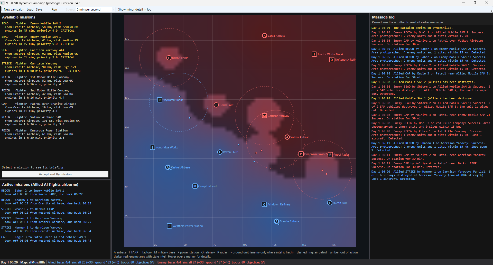

# Dynamic-Campaign-Engine
A dynamic campaign engine derived from the Enemy Engaged helicopter flight sim source code that is available for download.

It is written in C#, and was created for hopeful integration into VTOLVR to produce a similar but much more advanced gameplay that the Enemy Engaged series provided.

With these files, someone with the .NET 8 SDK on Windows can run "dotnet build", then "dotnet run --project CampaignDesktop".

***NOTE***
- Map path: the desktop and console apps look for afMtnsHills at your F: drive Steam path. On anyone else's PC that path won't exist, so the desktop app asks them to pick a .vtm file and the console asks for a path. People need VTOL VR with that custom map, or another custom map with at least two airbases.
